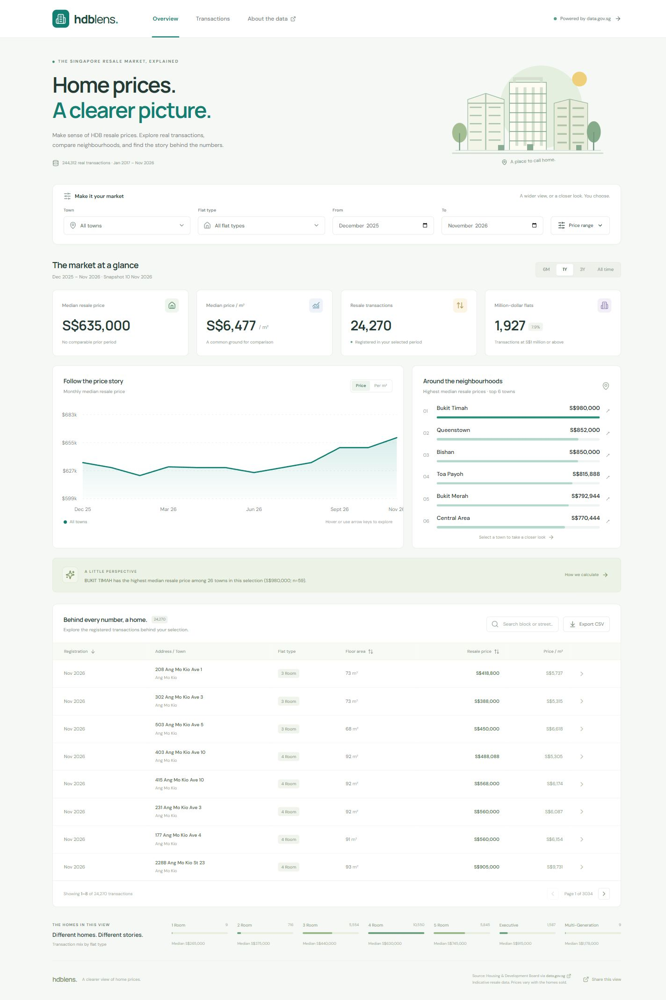

# HDB Lens

A full-stack Vue application for exploring Singapore HDB resale prices. Filter the market, compare towns, inspect monthly trends, and see the registered transactions behind every summary.



## Run locally

Prerequisites: **Node.js 24 LTS** (22.18+ is also supported) and **pnpm 11.25.0**. No AWS account, database, or data.gov.sg API key is required.

```sh
corepack enable
corepack prepare pnpm@11.25.0 --activate
pnpm install --frozen-lockfile
pnpm dev
```

Open **http://localhost:5173**. Vite proxies `/api` to the Express server at port 3001. Both processes run together and stop with Ctrl+C. The included data snapshot makes the first run independent of upstream API availability. Optional Google Fonts have local font fallbacks.

To run the production build:

```sh
pnpm build
pnpm start
```

Open **http://localhost:3001**. Express serves the built Vue application and API from the same origin. If a port is occupied, stop the other process before starting this app. See [Docker and AWS instructions](infra/README.md) for container execution and the optional deployment path.

## What you can explore

- Town, flat type, registration month, price range, and block/street search. Filters apply consistently to all summaries, charts, transactions, and CSV exports.
- Median resale price, median price per square metre, registered transaction volume, and million-dollar sales.
- An interactive monthly trend chart with keyboard navigation and price/per-m² controls.
- Town rankings, transaction mix by flat type, sortable pagination, and full transaction details.
- Shareable filter URLs, filtered CSV downloads, loading/error/empty states, and responsive layouts.
- An in-app explanation of the data, calculations, and limitations.

## Data and refresh

Source: **Housing & Development Board**, [Resale flat prices based on registration date from Jan-2017 onwards](https://data.gov.sg/datasets/d_8b84c4ee58e3cfc0ece0d773c8ca6abc/view), part of the [provided resale-price collection](https://data.gov.sg/datasets?topics=housing&resultId=189).

Dataset ID: `d_8b84c4ee58e3cfc0ece0d773c8ca6abc`. Data is reused under the [Singapore Open Data Licence](https://data.gov.sg/open-data-licence). The checked-in snapshot contains **244,312 real records from January 2017 through November 2026**, retrieved on 10 November 2026. November is incomplete. The snapshot metadata records retrieval time, observed coverage, row count, and SHA-256; the UI reports the date and coverage explicitly. See [snapshot provenance](data/README.md).

```sh
pnpm data:refresh
```

The refresh command uses the official [initiate-download and poll-download APIs](https://guide.data.gov.sg/developer-guide/dataset-apis/download-dataset), downloads the CSV, validates it, and replaces the local snapshot only after validation succeeds. Restart the backend after a refresh. Browsing the app reads the local snapshot and makes no upstream requests. This keeps responses predictable and avoids spending the shared upstream rate limit on every user interaction. An optional API key can raise upstream quotas; it stays on the server.

### How analysis works

The median is the middle sorted value, or the mean of the two central values for an even count. Median price per m² is the median of **each transaction's price divided by its area**. It is not the ratio of the two group medians. Million-dollar sales include prices exactly equal to S$1,000,000.

Period change compares the selected window against the immediately preceding window with the same number of calendar months and the same non-date filters. It is unavailable if a complete comparison window falls outside the snapshot, has no matching transactions, or the selection includes the Singapore calendar month in which the snapshot was retrieved. That latest month is treated as incomplete. Monthly summaries use registration month and show only months with matching transactions. Horizontal chart spacing follows elapsed calendar months. Town rankings and flat-type summaries use matching transactions in the selected window.

These summaries describe the homes that sold. Changes in location, size, model, floor, and remaining lease affect the mix, so a median change is **not a constant-quality price index**. Small samples may be volatile. The latest month may be incomplete. Remaining lease describes the transaction date. HDB excludes certain transactions that may not represent full market prices, such as transfers between relatives or part shares. The source itself describes prices as indicative.

## Engineering choices

| Area | Choice and rationale |
| --- | --- |
| Frontend | Vue 3 Composition API, TypeScript, Vite, and purpose-built SVG charts. Small bundles and accessible interaction without a large chart dependency. |
| Backend | Express with request validation, security headers, typed responses, and a read-only snapshot repository. Browsers never need an upstream API key. |
| Storage | A validated CSV snapshot loaded into memory at startup. Reproducible local setup with no database provisioning; appropriate for this bounded public dataset. |
| Analysis | Backend calculations ensure the chart, summary, pagination, and export use the same records. |
| Deployment | One container serves API and built frontend. Terraform defines ECS Fargate, ALB, ECR, networking, IAM, and CloudWatch. |
| Testing | Vitest, Vue Test Utils, and Supertest cover calculation semantics, query validation, integration, and user interactions. |

The in-memory approach intentionally trades horizontal scalability for a straightforward assessment setup. Filtering and aggregation are synchronous and linear in dataset size; use PostgreSQL with indexes/materialized aggregates or an analytics engine for larger histories or sustained concurrent traffic. CSV downloads are public records; the app does not collect personal accounts or maintain mutable user data. The AWS design bakes the snapshot into the container so replicas use the same version. Refresh locally, validate, and rebuild to update deployed data.

See [architecture and trade-offs](docs/architecture.md), [API reference](docs/api.md), [infrastructure documentation](infra/README.md), and [recorded verification results](docs/verification.md).

## Automated verification

```sh
pnpm typecheck
pnpm test
pnpm build
pnpm format:check
```

Tests run without the network and use bounded fixtures. They verify meaningful behaviour, including median arithmetic, filters, comparison windows, sorting, pagination, CSV escaping, malformed queries, chart keyboard navigation, and frontend API failure handling. The CI workflow repeats these commands and validates Terraform without deploying resources.

```sh
terraform -chdir=infra fmt -check
terraform -chdir=infra init -backend=false
terraform -chdir=infra validate
```

AWS deployment is optional and has not been applied. Infrastructure commands requiring AWS credentials are documented separately; normal app development does not use them.

## Repository layout

```text
client/                Vue UI, chart components, interaction tests
server/                Express API, data repository, analysis, API tests
shared/                Shared TypeScript contracts
scripts/               data.gov.sg ingestion command
data/                  Source snapshot and provenance metadata
infra/                 Terraform AWS infrastructure and deployment guide
docs/                  Architecture, API, and technical notes
.github/workflows/     Automated CI checks
Dockerfile             Multi-stage production image, non-root runtime
```

## Submission

The implementation, real data snapshot, automated tests, documentation, and IaC are maintained in [kennytanclwk/resale-flat-prices](https://github.com/kennytanclwk/resale-flat-prices) on the `main` branch. Submit this repository link for review. If the repository is private, grant the reviewers access before submission; no reviewer identities have been provided.
