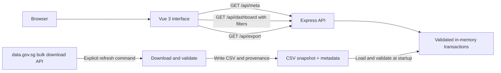
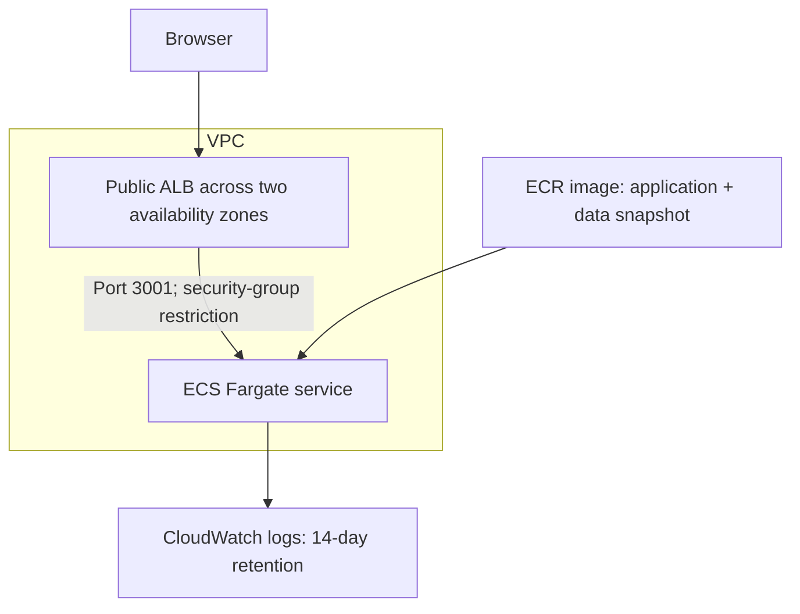

# Architecture and engineering decisions

HDB Lens is a Vue 3 application backed by a TypeScript/Express API. It analyses the Housing & Development Board's [resale transactions registered from January 2017 onwards](https://data.gov.sg/datasets/d_8b84c4ee58e3cfc0ece0d773c8ca6abc/view), from the collection supplied in the assessment. The runtime serves a checked-in data.gov.sg snapshot; ingestion is an explicit operation with provenance metadata.

## Request and data flow

The browser sends filters and receives aggregates and one page of transactions. Computing summaries in the API prevents the common error of calculating statistics from only the displayed page. The browser does not download the full CSV or communicate directly with data.gov.sg. Export applies the same filters as exploration and provides all matching records.

In development, Vite serves the Vue application and proxies `/api` requests to the backend on port 3001. In production, Express serves `dist/client` and the API from the same origin. A single application image avoids separate frontend/backend release coordination and CORS configuration. Shared TypeScript contracts describe the API payloads; Zod validates untrusted query parameters at runtime.

## Data integrity and analysis

The source has registration month, town, flat type, block, street, storey range, floor area, model, lease commencement year, remaining lease, and resale price. Numeric fields are validated during parsing. Source descriptions, coverage, retrieval time, and dataset identity are carried into API metadata and the interface. Refresh uses data.gov.sg's initiate-download/poll-download flow with bounded waits and timeouts; its API key is optional and stays on the server/operator side.

The checked-in CSV allows deterministic local startup and review when the external service is unavailable or rate-limited. The application does not describe a local snapshot as a live feed. Refreshing requires an explicit command and a server restart; container deployments require a rebuilt image. The runtime never makes a large public-data request in response to a user's filter interaction.

Medians are calculated over all matched transactions. For an even record count, the median is the average of the two middle values. Price per square metre is calculated for each transaction before taking its median; dividing the median price by median floor area would be a different statistic. Dates refer to registration months and contain no day-level precision.

The five-number price distribution uses every filtered transaction rather than a page of rows. Its minimum, lower quartile, median, upper quartile, and maximum are derived from one sorted price array; quartiles use the documented R-7 interpolation method. The median from that same distribution supplies the headline resale-price metric. Empty and constant samples have explicit rendering, and a visible note identifies cohorts below 30 records. The 30-record threshold is a usability cue, rather than a claim of statistical significance.

The interpolation definition corresponds to [type 7 in the R statistics documentation](https://stat.ethz.ch/R-manual/R-devel/library/stats/html/quantile.html). Other valid quartile conventions can produce different results on small datasets; this method is documented so reviewers can reproduce the numbers.

Percentage movement compares a selected window with the immediately preceding window of equal calendar length and identical non-date filters. If the preceding window is not fully inside the snapshot, or has no matching transactions, comparison is unavailable. Selections including the Singapore calendar month of snapshot retrieval also omit the percentage because that month is incomplete. This avoids comparing unequal windows or presenting partial-month movement as a complete-period comparison. The interface exposes the available coverage.

The API exposes a typed comparison reason separately from its human-readable label, so the UI does not parse message text to decide what to show. Metadata reports the latest closed month within coverage. A complete-month shortcut shifts the selected window to that boundary and retains all non-date filters. Shared calendar helpers keep the ingestion metadata, analysis, and interface consistent at Singapore month boundaries.

Monthly price trends, town medians, flat-type summaries, million-dollar transaction counts, and median floor area describe the matching transactions. They are descriptive summaries, not a valuation model. Changes in the mix of flat sizes, towns, lease ages, and floors can change aggregate medians without representing the change in value of a comparable flat. HDB's source notes exclude some transactions that do not reflect full market prices and describe agreed resale prices as indicative.

## Boundaries and trade-offs

| Decision | Benefit | Limitation / next step |
| --- | --- | --- |
| Vue 3 Composition API and TypeScript | Clear reactive state and shared API contracts | Runtime input validation remains necessary |
| Express API with in-memory snapshot | Simple local setup; fast exploration at assessment scale | Each replica holds the dataset; filtering and aggregation are CPU-bound |
| Explicit ingestion with checked-in source data | Repeatable offline review and visible provenance | Snapshot freshness depends on an operator refresh |
| One image serves UI and API | Same-origin access and one release unit | Independent scaling or CDN asset delivery would need separation |
| Deterministic server-side summaries | Consistent results for every client and page | Repeated queries recompute aggregates; add indexed storage/cache when measured load warrants it |
| No application database | No migration or database setup for immutable public data | A growing history or user-saved searches would justify persistent indexed storage |
| No sign-in | Public dataset needs no user identity | User accounts or saved private preferences are outside the assessment scope |

For substantially larger datasets or heavier traffic, use a durable raw-data store, an ingestion job, and an indexed analytical store with precomputed monthly aggregates. Add caching keyed by validated filters, request-rate limits, performance budgets, and operational alarms based on measured needs. A single-process service should be load-tested before increasing replica counts; replicas do not share memory caches.

## Deployment topology

The Terraform configuration defines networking, security groups, ECR, IAM, Fargate, load balancing, health checks, and logs. The default one-task deployment is a small assessment environment; two subnets alone do not make the application highly available. The image is immutable and the runtime filesystem is read-only. The application task has no AWS API permissions. Optional ACM input enables HTTPS and HTTP redirection. See [the infrastructure guide](../infra/README.md) for bootstrap, operation, and cost trade-offs.

## Verification strategy

Automated tests cover statistical edge cases, filtering, sorting, pagination, query validation, API errors, CSV output, and frontend interaction/state. Tests use deterministic fixtures and do not depend on live upstream responses. Type checking verifies both Vue and backend contracts, and the production build compiles both runtime components. CI runs installation from the lockfile, type checks, tests, the production build, and Terraform format/configuration validation. Deployment and live upstream availability are separate checks and are not claimed by CI.

The refresh command validates downloaded records before replacing the local files. Its bounded retry behavior preserves an actionable failure when the upstream is unavailable. Network integration remains an operator check because public API rate limits and data updates would otherwise make the test suite nondeterministic.
